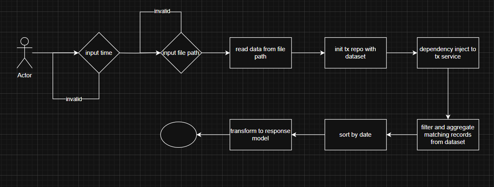

# sandbox

Small Go programs I use to try things out.

## walletlog

A command-line tool that reads a CSV ledger of deposits and withdrawals and prints
the statement for one month as JSON.

```bash
go run .
# Enter history time (YYYYMM): 202401
# Enter file path: ./data.csv
```

`data.csv` holds sample data; `output/` has a sample CSV and JSON export.

### Input

A CSV file with the header `date,amount,content`:

| Column    | Type                                   |
|-----------|----------------------------------------|
| `date`    | `YYYY/MM/DD`                           |
| `amount`  | integer; negative for a withdrawal     |
| `content` | free text                              |

Rows may be in any order and may span any number of months; only the requested
month is reported.

### Output

JSON on standard output: `period`, `total_income`, `total_expenditure`, and
`transactions` sorted by date, newest first. The service can also write the same
statement to a CSV or JSON file (`ExportTxToCSV`, `ExportTxToJSON`).

### Layout

- `repositories/` loads the ledger (the CSV is parsed by a small worker pool) and
  filters it by date range.
- `services/` turns a month into a date range and builds the response;
  `services/builder/` maps the storage model to the response model.
- `mocks/` are generated with mockery for the two interfaces.

Interfaces between the layers mean the CSV store could be swapped for a database
without touching the service.



### Test

```bash
go test ./...
```
